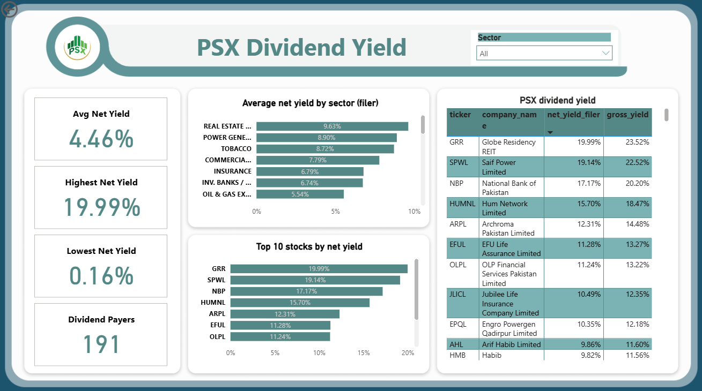

# PSX Dividend & Personal Wealth Lakehouse

An automated pipeline for the Pakistan Stock Exchange (PSX). Every trading day it collects closing prices and dividend announcements, cleans them, works out the dividend you actually receive after withholding tax, and serves star-schema tables to a Power BI dashboard.



## Why this exists

Tracking PSX dividends by hand in spreadsheets is slow and easy to get wrong:

- **Yahoo Finance has no data for many PSX tickers.** The first version used it and returned "No data found" for about half the symbols.
- **PSX publishes dividends as text**, for example `60%(iii) (D)`. The text has typos, repeated entries, and bonus and rights shares mixed in with cash dividends.
- **A dividend is a percentage of face value, and face value is not always Rs.10.** AHCL has a face value of Rs.1, so a 125% dividend is Rs.1.25 a share, not Rs.12.50.
- **The announced amount is not what you receive.** Pakistan withholds tax on dividends: 15% for filers and 30% for non-filers (rates from the project spec; verify against current FBR rules).
- **Tax rules change.** The rates live in a table with effective dates, so old dividends keep the rate that applied at the time.

## Architecture

```
cron-job.org  (Mon-Fri 4:30 PM Pakistan time)
     |  GitHub API: workflow_dispatch
     v
GitHub Actions
     |  1. scrape PSX: prices, dividends (and face values on the first Monday of the month)
     |  2. upload dated CSV files to a Unity Catalog Volume
     |  3. start the Databricks job
     v
Databricks Free Edition
     Volume: /Volumes/workspace/bronze/landing
        |
        v   01_bronze_ingest   raw text + source file + load time
     BRONZE  prices, dividends, reference, face_value
        |
        v   02_silver_transform   types, dedupe, quarantine, tax logic
     SILVER  prices, prices_quarantine, dim_tax_rate, dividends_cash,
             corporate_actions, dividends_net
        |
        v   03_gold_model   star schema
     GOLD    dim_date, dim_asset, fact_equities, fact_dividends, v_dividend_yield
        |
        v
Power BI Desktop (Import mode)
```

## Layers

### Ingestion (GitHub Actions)

- `scraper.py` pulls prices for about 770 non-debt tickers (bonds, T-bills and TFCs are skipped using the `is_debt` flag from PSX's symbol list) and every dividend announcement.
- Since September 2026, PSX rejects data requests that lack an `X-Req-Id` token. The token is embedded in PSX's HTML pages. The [`psxdata`](https://pypi.org/project/psxdata/) library fetches it, and `scraper.py` reuses that session for the dividend endpoint.
- The dividend parser (`parse_details`) handles clean text, typos such as `12.5%(ii (D)` and `360%i) (D)`, entries with no type letter, items repeated inside one cell, and rights shares with a price.
- `scrape_face_value.py` reads each company's face value from the Equity Profile on its PSX page. It runs on the first Monday of every month, or on request.
- `upload_to_databricks.py` sends every file under `bronze/` to the Volume through the Databricks Files API.
- The workflow then starts the Databricks job through the Jobs API (`run-now`).
- GitHub's own `schedule` trigger ran late and unreliably, so cron-job.org starts the workflow at 4:30 PM Pakistan time.

### Bronze

Append-only dated CSV files, one per run: `prices_YYYYMMDD.csv`, `dividends_YYYYMMDD.csv`, and so on. Each daily run re-pulls the last 5 days of prices, and a one-off backfill loaded about two years of history. Bronze keeps everything as text. Each row gets `_source_file` and `_loaded_at`.

### Silver

- Types are set and duplicates removed (the same ticker and date appear in several daily files).
- Rows that fail checks (`is_anomaly`, missing ticker, non-positive close) go to `prices_quarantine`. They are kept, not deleted.
- `dim_tax_rate` is a Slowly Changing Dimension (Type 2): `filer_status`, `tax_rate`, `effective_from`, `effective_to`, `is_current`. `change_tax_rate()` closes the current row and opens a new one.
- `dividends_cash` holds cash dividends only, with the rupee amount per share from the percentage and the company's face value. A ticker with no scraped face value falls back to Rs.10 and is marked `assumed`.
- `corporate_actions` holds bonus and rights shares. They change the share count, not income, so they are kept apart from cash.
- `dividends_net` joins each cash dividend to the tax rate valid on its effective date, for both filer and non-filer.

### Gold

| Table | Grain |
|---|---|
| `dim_date` | one row per calendar day |
| `dim_asset` | one row per ticker (equities, ETFs and preference shares; no debt) |
| `fact_equities` | ticker per trading day: OHLC, volume, previous close, daily return |
| `fact_dividends` | one row per cash dividend: gross, tax rate and net for filer and non-filer |
| `v_dividend_yield` | trailing 12-month yield per ticker, with `needs_review` and `face_value_source` |

Dividends have their own fact table. Prices only go back as far as Bronze does, so joining dividends onto price rows would silently drop every older dividend.

### Power BI

Three pages, built on Gold: **Yield ranking**, **Dividend history** (one stock at a time) and **Price trend**. The page 1 filters exclude ETFs and flagged tickers.

## Data quality

- Hand checks against the source data: HBL, AHCL, DLL, ABOT and CENI dividends add up to the figures in `v_dividend_yield`. AHCL fell from a false 91% yield to about 9% once its real face value was used.
- `needs_review` is true when a trailing gross yield is above 25% or the face value is a guess. At the last check it flagged 14 tickers: 9 ETFs, 3 preference shares, CENI and LOTCHEM.
- Duplicate and orphan checks run at the end of the Silver and Gold notebooks and return zero rows.

## Known limits

- **Tax rates** are 15% (filer) and 30% (non-filer) from the project spec. Some sectors may differ. Check against current FBR rules before relying on the net figures. REIT distributions (for example GRR) are not verified.
- **ETFs and preference shares** have no face value on PSX, so a Rs.10 guess is used and flagged. ETF yields are not trustworthy and are hidden on the ranking page.
- **Prices are not adjusted** for bonus shares or rights issues. A bonus or rights issue shows as a drop in the price line.
- **The yield is trailing**, not a forecast. A one-off special dividend inflates it.
- **Databricks Free Edition** has usage quotas and one small SQL warehouse, and the account can be removed after long inactivity.
- **Power BI Desktop** does not refresh by itself. Click Refresh to load the newest data.

## Setup

1. Create a Databricks workspace, a schema `workspace.bronze` and a Volume `landing`.
2. Create a Databricks job that runs the three notebooks in order (`notebooks/`). Note its Job ID.
3. In the GitHub repository, add the secrets `DATABRICKS_HOST` (the workspace URL, no trailing slash) and `DATABRICKS_TOKEN`.
4. Put the Job ID in the "Run Databricks job" step of `.github/workflows/daily_scraper.yml`.
5. Create a cron-job.org job: `POST https://api.github.com/repos/<user>/<repo>/actions/workflows/daily_scraper.yml/dispatches`, body `{"ref":"main"}`, headers `Authorization: Bearer <GitHub token>` and `Accept: application/vnd.github+json`.
6. In Power BI Desktop, connect with the Azure Databricks connector (server hostname and HTTP path from the SQL warehouse) and load the `gold` tables.

Tokens expire. Renew the Databricks token (GitHub secret), the GitHub token (cron-job.org) and the Power BI token before their dates. An expired token stops the daily run or the refresh without a warning.

## Repository layout

```
.github/workflows/daily_scraper.yml   daily workflow
scraper.py                            prices and dividends, parser
scrape_face_value.py                  face value per ticker
upload_to_databricks.py               Volume upload
notebooks/                            01_bronze_ingest, 02_silver_transform, 03_gold_model
requirements.txt
docs/                                 screenshots
```

## Stack

Python (`psxdata`, BeautifulSoup, pandas), GitHub Actions, cron-job.org, Databricks (PySpark, Delta Lake, Unity Catalog Volumes, Jobs API), Power BI.

## Possible next steps

- A holdings table (ticker and share count) to show your own expected dividend income.
- Adjustment of history for bonus and rights issues.
- A per-fund rule for ETF distributions.
